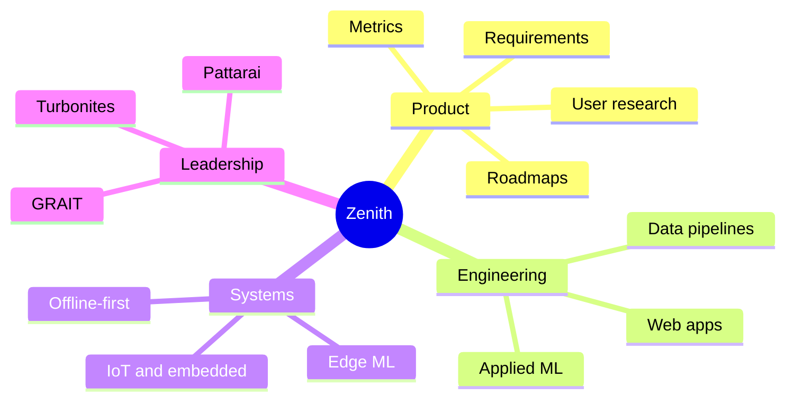
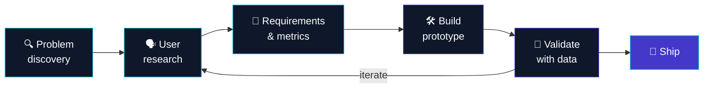
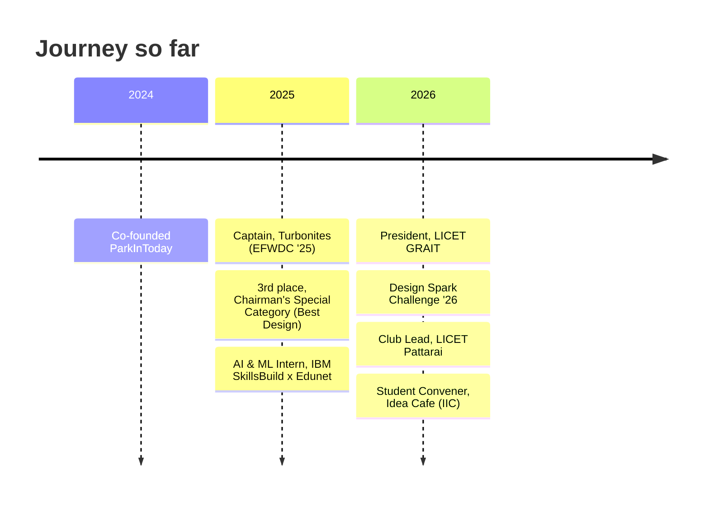

<!-- ============ HEADER ============ -->

 

 

<!-- ============ ABOUT ============ -->
## 🧭 About Me

Final-year **B.Tech IT** student at **LICET, Chennai**, working in the gap between **product decisions** and **engineering execution**. I take a problem from user research all the way to a shipped, measured prototype, with a focus on **underserved, tier-2/3 Indian contexts**.

> *A convincing demo is a starting point. Reliability, measurable value and real-world validation make a product credible.*

 

<!-- ============ HOW I WORK ============ -->
## ⚙️ How I Work

 

<!-- ============ PROJECTS ============ -->
## 🚀 Featured Projects

<table>
<tr>
<td width="50%" valign="top">

### 🧾 EazyLogs
**Offline-first billing & ops for small businesses**

Local-first workflows with optional sync, built to prevent silent data overwrites on patchy networks.

`Flutter` `Dart` `SQLite`

[🔗 Live prototype](https://eazylogs.vercel.app/)

</td>
<td width="50%" valign="top">

### 🎯 EngineerFit
**Psychometric job profiling for tier-2/3 engineers**

IRT-based readiness scoring. Case study: **+20% shortlisting efficiency** vs keyword matching.

`React` `Supabase` `TypeScript`

[🔗 Repo](https://github.com/Jos-zenith/engineerfit_)

</td>
</tr>
<tr>
<td width="50%" valign="top">

### 🔎 Trustify
**Hybrid payment-fraud detection**

Rules + Graph Isomorphism Network to flag P2P mule networks, with Kafka/Kinesis micro-batching and a **SHA-256 hash-chained audit ledger**.

`PyTorch Geometric` `FastAPI` `Kafka`

</td>
<td width="50%" valign="top">

### ❤️ Cardiac Arrhythmia Research
**Noisy single-lead ECG beat detection**

Signal filtering + lightweight ML with an embedded target. *Research prototype, not a clinically validated device.*

`Python` `Signal Processing` `ESP32`

</td>
</tr>
<tr>
<td width="50%" valign="top">

### 🌾 Uzhavan
**Agri weather-risk monitoring**

Risk scoring with uncertainty, alerts and an officer-oriented workflow.

`TypeScript`

[🔗 Repo](https://github.com/Jos-zenith/uzhavan)

</td>
<td width="50%" valign="top">

### 🅿️ ParkInToday
**Smart parking startup** (Co-Founder & CTO)

Built from **200+ user conversations** in Chennai: live occupancy, discovery, booking, payments.

`Product` `IoT`

[🔗 Overview](https://parkin-olive.vercel.app/)

</td>
</tr>
</table>

[**📂 Browse all repositories →**](https://github.com/Jos-zenith?tab=repositories)

 

<!-- ============ TOOLKIT ============ -->
## 🧰 Tech Stack

**Languages** 

**Web & Apps** 

**AI / Data / Embedded** 

**Product & Design Tools** 

Reflects areas I've worked with or explored, not equal depth in every tool.

 

<!-- ============ LEADERSHIP ============ -->
## 🏆 Leadership & Milestones

| Role | Where | What I did |
|---|---|---|
| 🌱 **Club Lead** | LICET Pattarai | Founded a daily build-and-mentoring activity solving real problems with design thinking |
| 🎓 **President** | LICET GRAIT | Run department ops and flagship symposium end to end |
| 🧪 **Student Convener** | LICET IIC · Idea Cafe | Programme taking members from research questions to proposals |
| 🏎️ **Team Captain** | Turbonites · SAEISS EFWDC '25 | Led 20+ people building an electric four-wheeler |

 

<!-- ============ STATS ============ -->
## 📊 GitHub Analytics

 

<!-- ============ CERTS ============ -->
## 📜 Certifications

 

<!-- ============ NOW ============ -->
## 🎯 Currently Working Towards

- 🔌 Dependable, offline-capable software for real operating environments
- 🫀 Edge ML that is measurable, resource-aware and robust to noisy inputs
- 📈 Sharper product judgment through user evidence, clear metrics and fast experiments
- 🧱 Turning prototypes into systems that survive realistic testing, not just a demo

 

<!-- ============ CONNECT ============ -->
## 🤝 Let's Connect

Open to collaborating on **applied AI, IoT, product engineering, developer tools and practical research**.

 

*Build with intent. Measure what matters. Be honest about what isn't proven yet.*

